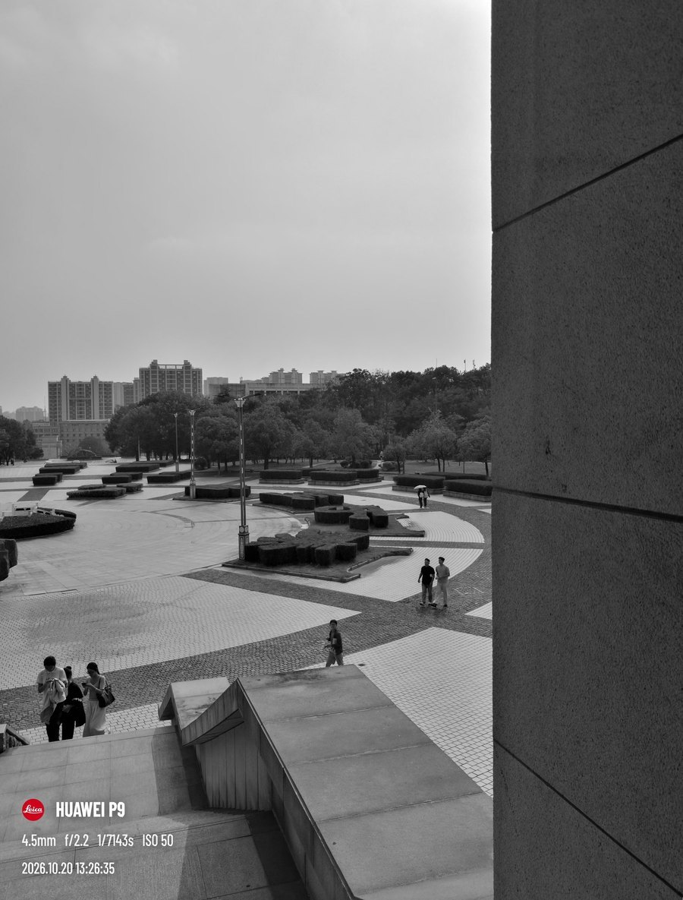
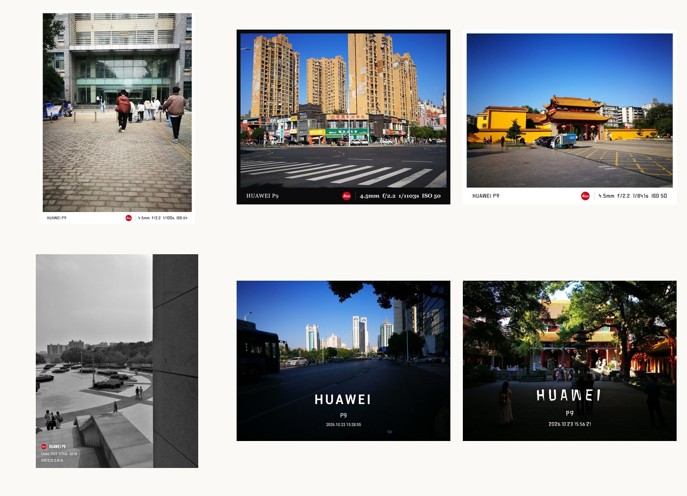
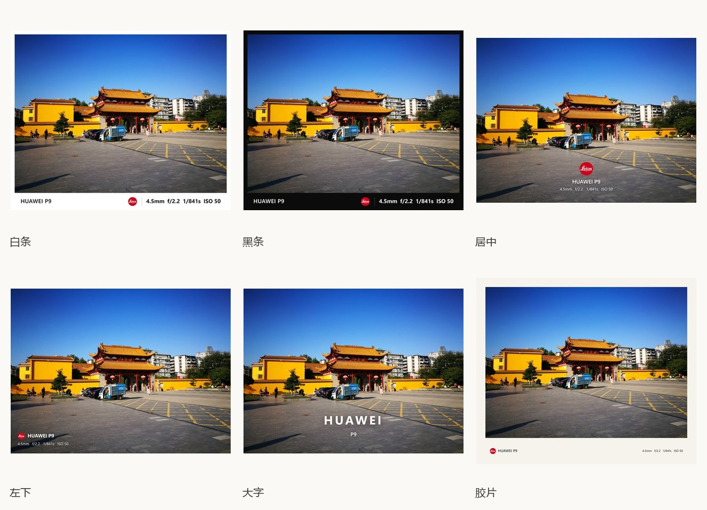

# 德味水印

给照片底部加一条参数水印的单文件工具。拖一张照片进去，自动读出机型、焦距、光圈、快门、ISO，排成一行字画在照片边上。

安卓有安装包，电脑打开网页就能用。全程在本机跑，不联网，照片不出门。



---

## 下载

两个入口给的是同一个文件，任选其一。

| 渠道 | 地址 | 说明 |
|:--|:--|:--|
| **国内直链** | https://gitee.com/tom-wall/dewei-watermark/raw/master/download/P9Watermark.apk | 最快，地址固定，推荐 |
| **蓝奏云** | https://wwbao.lanzouq.com/ixRzu4fxgypi | 提取码 `7qav`，国内备用 |

- 版本 **v1.1.10** · **629 KB** · Android 5.0 及以上
- SHA-256 `b1b9e7ebce4334557718d3a6242088291fa8589dd9004ebbd12c752d6cad7dca`
- **在线试用**（不用装）：https://ellardomme.github.io/HUAWEI_P9_Leica_Watermark_Tool/

## 效果

下面都是在手机上导出的原图，没有额外修图。



## 六种版式



| 版式 | 样子 | 适合 |
|:--|:--|:--|
| **白条** | 底部白条，左侧机型、右侧参数 | 最通用，接近官方样张 |
| **黑条** | 暗色底条，白字 | 夜景、暗调照片 |
| **居中** | 图标在上，两行文字居中 | 竖构图、社交平台 |
| **左下** | 角标署名，压在画面角落 | 街拍、纪实，不挡主体 |
| **大字** | 品牌名做主视觉 | 作品封面 |
| **胶片** | 米色画框，参数落在留白里 | 日系、胶片模拟 |

## 怎么用

1. **拖入照片** —— JPG / PNG / WebP 都行，EXIF 自动读；读不到可以手填
2. **挑版式、调参数** —— 字号、位置、深浅、间距，改哪看哪，预览即时更新
3. **导出** —— 按原图尺寸出图。App 版直接进相册，网页版下载到本地

> 导出文件名为 `原文件名-wm-日期-时间.jpg`，重复导出不会覆盖。

## 功能

**读取与填写**

- 自动解析 EXIF：机型、焦距、光圈、快门、ISO
- 品牌 / 设备名 / 后缀 三段拆分，后缀可拼 `by Leica`、`| HASSELBLAD`
- 六个字段都能手改；EXIF 被抹掉（比如过一遍微信）也不影响使用

**版面**

- 六种版式，每种的比例都按实拍样张量过
- 白条高度、白边宽度、图标大小、整体字号、垂直位置、图标间距全部可调，按图宽百分比缩放，预览和 4K 导出一致
- 胶片模板有独立行距；居中的设备名与参数之间也有独立行距
- 文字颜色默认按照片底部亮度自动判定，也能强制白 / 黑
- 设备名、日期、参数各有独立深浅滑杆

**字体**

- 默认（系统）/ DIN / 等宽 / 衬线 / 人文 / HarmonyOS / 徕卡复刻 / 徕卡复刻·细体 / 徕卡复刻·糙体
- 三套徕卡字体按刻字样张逐字重绘，73 个字形，400 与 700 两档，按字族做了尺寸补偿，和系统字体同宽
- 除「默认」外全部内嵌，手机和电脑渲染一致；中文仍走系统字体

**导出**

- JPEG（质量可调）或 PNG
- 长边上限 4096 px，重复导出自动加序号
- 预设可另存为 / 覆盖 / 重命名 / 删除，也能导出 JSON 备份

## 兼容性

**安卓 App**

- Android 5.0（API 21）及以上，已适配到 Android 14
- 包名 `com.ellardomme.p9watermark`，629 KB
- 只申请一个权限：写入相册（`Pictures/德味水印`）
- 返回键：先关浮层，主界面双击退出

**网页版**

- 需要 Chromium 55+ 的浏览器（Chrome、Edge 等）
- 用 `file://` 打开时预设可能存不住，这是浏览器对本地存储的限制；App 版没有这个问题
- 1200 万像素导出比较吃内存，老机器建议把尺寸设为长边 2048

**格式**

- 支持 JPG / PNG / WebP
- **不支持 HEIC**，iPhone 照片建议先导出为 JPG
- 加水印只改像素，不回写 EXIF

## 隐私

- 没有任何网络请求，断网照常使用
- 照片只在内存里解码、绘制，关闭即释放
- 预设和图标存在本机，不上传、不同步

## 说明与免责

本项目内嵌 Leica 红点标，**仅用于个人学习与本地排版示意**。

- 「Leica」及相关标识是 **Leica Camera AG** 的注册商标，本项目与其**无任何关联**，也未获授权
- 请勿用于商业用途、批量生成冒充官方样张的图片，或任何可能误导他人的场景
- 再分发前请把图标换成自己的素材（软件里「上传」支持 PNG / SVG / JPG / WebP）
- 仓库不含第三方摄影作品；`开发文件/reference/` 中的参考图只在本地对照，未上传
- 逐项素材来源、权利归属与下架流程见 [NOTICE.md](NOTICE.md)

## 开发

<details>
<summary>文件结构</summary>

```
P9徕卡水印工具/
├─ index.html          # 网页版：EXIF 解析 + 六套模板 + 预设（也是 App 的内核）
├─ android/            # WebView 壳：把 index.html 打进 APK
├─ welcome/            # 官网页面
├─ download/           # 固定地址的安装包（官网直链）
├─ docs/images/        # 本说明用图
├─ LICENSE             # MIT
└─ 开发文件/            # 用户不需要碰
   ├─ fonts/           # 字体源文件
   ├─ tests/           # 自动化测试
   └─ reference/       # 参考素材（不发布）
```

</details>

<details>
<summary>改版式</summary>

`index.html` 里搜 `function drawBar` / `drawCenter` / `drawCorner` / `drawWordmark` / `drawFilm`，
每个模板的尺寸都是「图宽 × 系数」，改一个数字就能调比例。配色、字号、间距都在函数顶部几行。

改完网页版刷新即可；要重新出 APK 见下一节。

</details>

<details>
<summary>重新打包 APK</summary>

需要 JDK 与 Android SDK（`build.ps1` 顶部写死了本机路径，换机器要改 `$sdk`）：

```powershell
powershell -ExecutionPolicy Bypass -File android\build.ps1
```

脚本会把根目录的 `index.html` 复制进 `assets/`，依次执行
aapt2 → javac → d8 → 加 dex → zipalign → apksigner，最后同步到 `download/` 和 `welcome/download/`。

</details>

<details>
<summary>自动化测试</summary>

`开发文件/tests/` 是一套基于 CDP 的测试（Node 22+，用本机 Edge 无头模式）：

```powershell
node 开发文件/tests/cdp_test.mjs
```

覆盖画布渲染、EXIF 解析、六套模板、八种字体、时间精度、PNG/JPEG 状态、滑杆与开关、
图标切换、预设保存与重载、导出尺寸与编码。这是桌面 Chromium 环境的测试，真机仍需人工验收。

</details>

## 许可

MIT。见 [LICENSE](LICENSE)。
