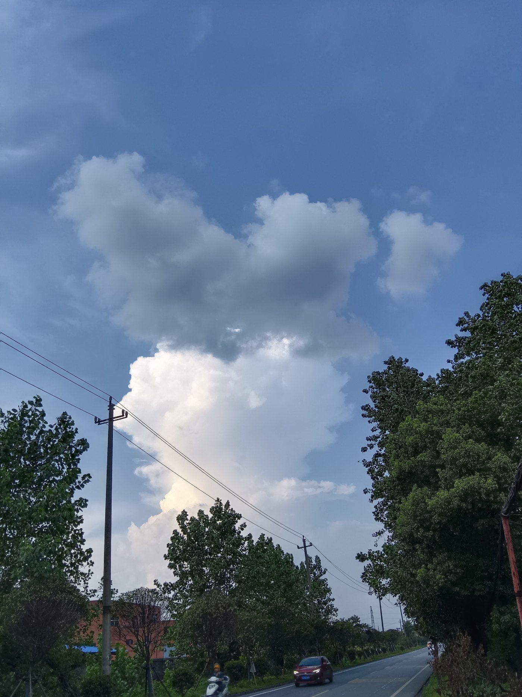
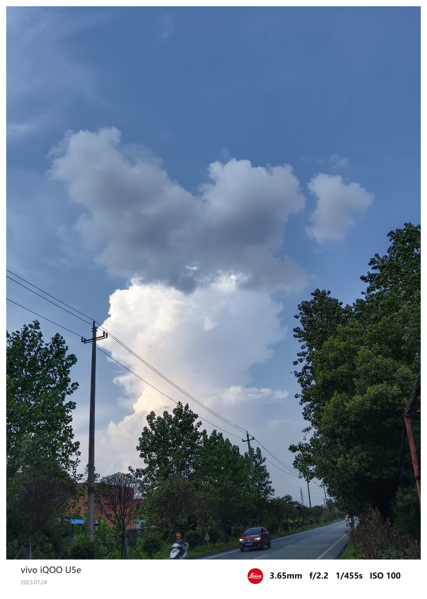
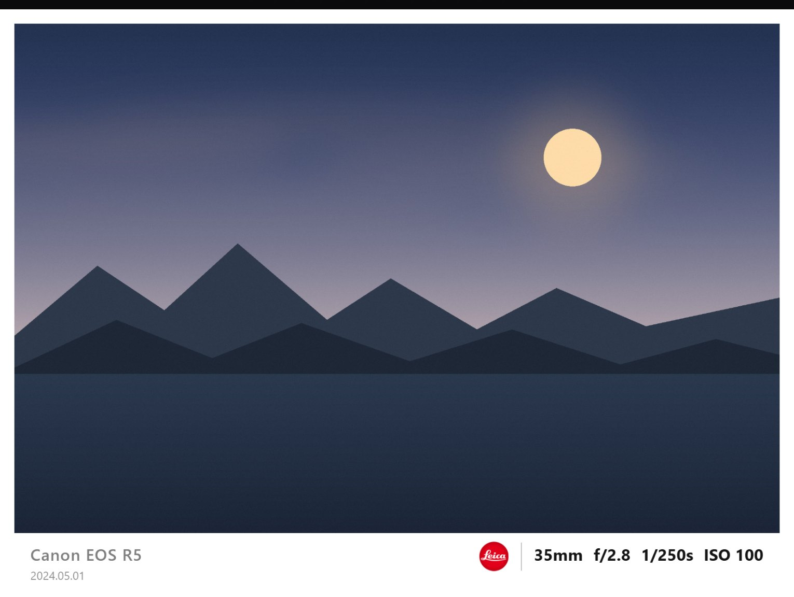
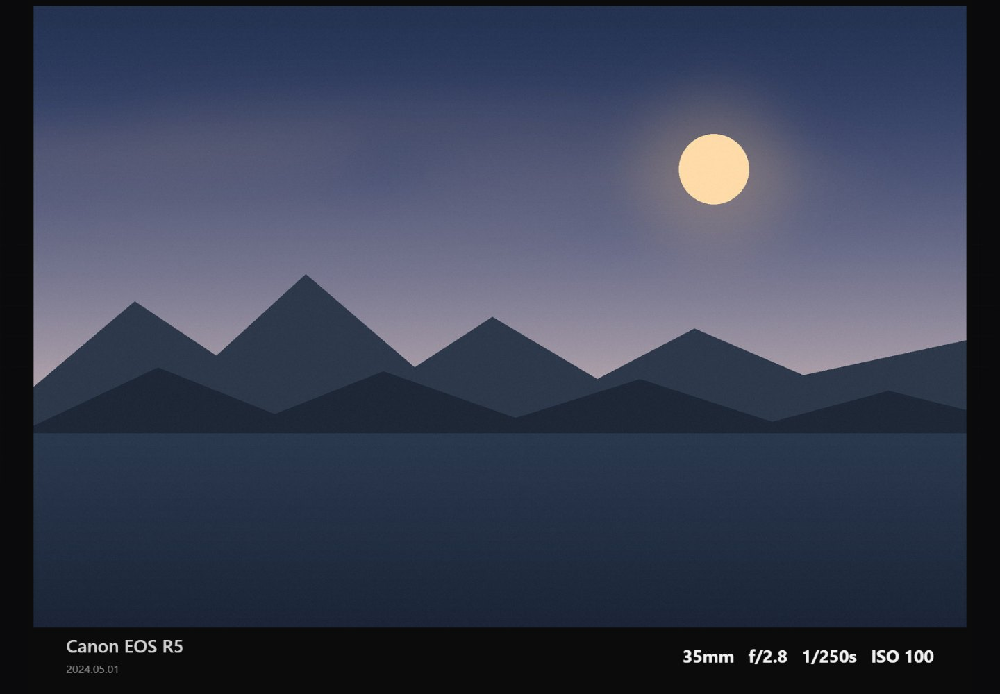
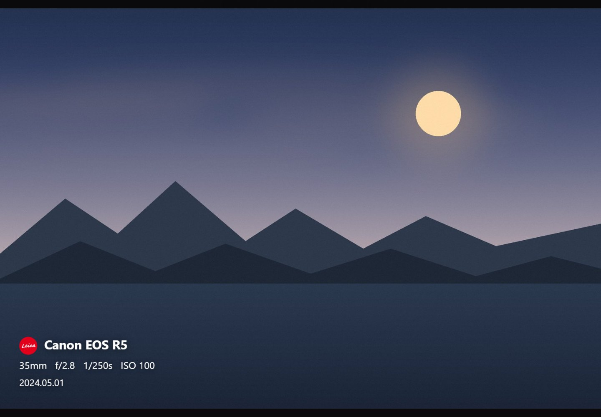
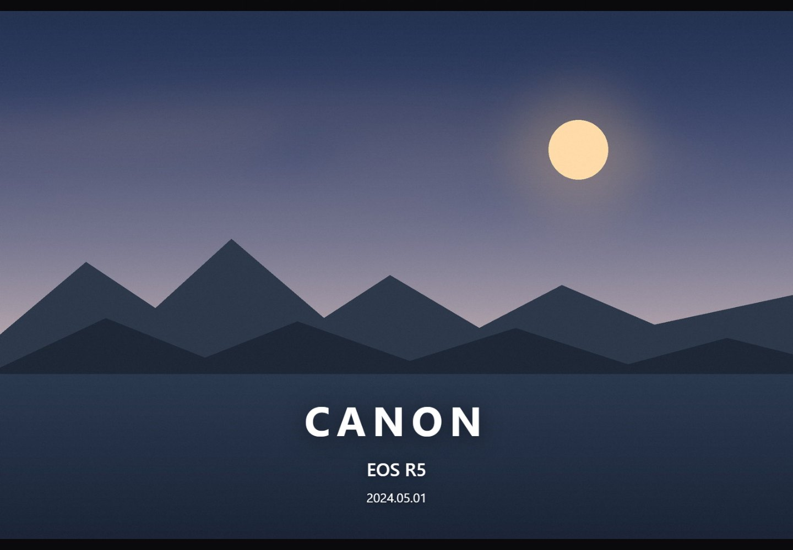
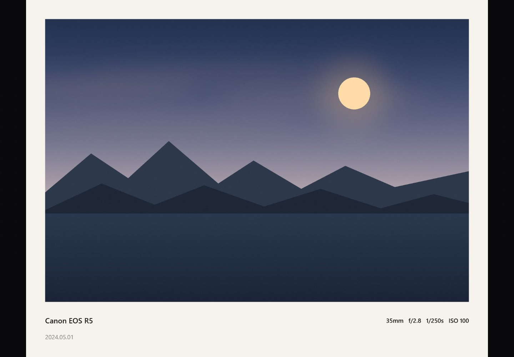

# 华为 P9 徕卡水印 · 本地离线复刻版

为华为 P9 而起的水印工具：**任意品牌机型都能用**，填自己的品牌和设备名即可。

两种用法，同一套功能：

| 用法 | 适合 | 说明 |
|---|---|---|
| **安卓 App（APK）** | 手机上处理照片 | 装好就是普通应用，导出直接进相册，不需要浏览器 |
| **网页版（index.html）** | 电脑上处理、或临时用 | 双击即开，离线可用，不需要安装 |

> **下载 APK**：[v1.0.67](https://github.com/EllarDomme/HUAWEI_P9_Leica_Watermark_Tool/releases/latest)（Android 5.0+，548KB）
> **在线试用**：<https://ellardomme.github.io/HUAWEI_P9_Leica_Watermark_Tool/>

不上传、不联网、不装任何第三方组件，照片和预设全部留在本机。

> ⚠️ **本工具是个人学习作品，与华为、Leica Camera AG 均无关联，未获授权或认可。**
> 内嵌的徕卡红点标属于 Leica 的注册商标，仅作个人本地排版示意；如需再分发，请用软件里的
> 「上传」换成自己的图标。完整的素材来源与权利说明见 [NOTICE.md](NOTICE.md)。




*左：华为 P9 原片 ｜ 右：同一张加完水印（白条模板）*

---

## 在手机上用（推荐）

1. 打开 [Releases](https://github.com/EllarDomme/HUAWEI_P9_Leica_Watermark_Tool/releases/latest)，下载 `P9Watermark-vX.Y.Z.apk`
2. 点安装；系统提示「未知来源」时允许一次（只有首次需要）
3. 打开 App → 选照片 → 调模板和文字 → 导出
4. 导出的图直接进相册 `Pictures/P9Watermark`，不用手动找文件

App 只要一个权限：**写入相册**。没有网络权限，也读不到你的其它文件。

## 在电脑上用

- **直接打开**：双击 `index.html`（Edge / Chrome 均可，`file://` 下就能跑）
- **手机临时访问电脑**：双击 `开发文件/serve.cmd`，同一 Wi-Fi 下用手机打开 `http://电脑IP:8765`
- 把照片拖进左侧，或 `Ctrl+V` 粘贴截图；`Ctrl+O` 打开，`Ctrl+S` 导出
- 网页版导出时会弹「另存为」，自己选目录即可（这是浏览器对本地页面的限制，App 版没有）

---

## 六套模板

| 模板 | 参照的版式 | 适合 |
|---|---|---|
| **白条** | 华为 P9 + 徕卡红标，白底参数条 | 最通用，像官方样张 |
| **黑条** | 华为 P9 Plus，暗底参数条 + 两行 | 夜景、暗调照片 |
| **居中** | 小米 17 Ultra，红标在上、参数在下 | 竖构图、发小红书 |
| **左下** | SHOT ON XIAOMI 角标 | 不挡画面，街拍纪实 |
| **大字** | LUMO / OPPO 品牌大字 | 作品封面、品牌感 |
| **胶片** | 画框留边，底部排字 | 日系、胶片模拟 |








---

## 功能一览

- **自动读 EXIF**：机型、焦距、光圈、快门、ISO 自动填；读不到或想改，直接手输入框
- **品牌 / 设备名 / 后缀** 三段拆分，后缀用来拼 `by Leica`、`| HASSELBLAD` 这类
- **图标**：无 / 内嵌徕卡红标 / 上传自己的 PNG·SVG·JPG·WebP，按比例自动缩放
- **文字颜色自动判定**：采样照片底部亮度，深色照片自动白字、浅色自动黑字，也能强制白/黑
- **三档深浅**：设备名、日期、参数各有独立滑杆；白 / 墨黑 / 深灰三套参数互相独立保存
- **拍摄时间可开关**：关掉后任何模板都不画日期，参数条不会留空行
- **字体**：默认（系统）/ DIN 工业 / 等宽 / 衬线 / 人文 / HarmonyOS / **徕卡复刻 / 徕卡复刻·细体 / 徕卡复刻·糙体**
  除「默认」外全部内嵌，手机与电脑渲染一致；中文仍走系统字体
- **徕卡复刻字体**：按刻字样张逐字重绘，73 个字形，大写统一 700 高、基线归零；
  细体为常规内缩，糙体带逐字倾斜与笔画收放；三套均含 400/700 两档，含 265 组字偶距
- **条高 / 字号 / 图标大小 / 垂直位置 / 图标间距**：全部按图宽百分比缩放，4K 导出和预览比例一致
- **预览可缩放**：双指缩放、拖动、双击切换；工具栏有 − / 百分比 / +
- **预设**：另存为 / 覆盖保存 / 重命名 / 删除；导出备份 JSON，换设备可恢复
- **首次使用提示**：第一次打开会显示一次「使用须知」（非官方声明），点「我知道了」后不再出现；
  面板底部「关于本工具」可随时再看
- **原图尺寸导出**：JPEG（质量可调）或 PNG，文件名加 `-wm`

---

## 导出到哪里

App 版：直接写入相册 `Pictures/P9Watermark`，不弹对话框。

网页版：点「导出」会先弹系统的**另存为**对话框：

- 自己选目录、改文件名，确认后写入；默认文件名是 `原文件名-wm.jpg`
- 浏览器会记住上次保存的目录，下次默认停在那里
- 点「取消」= 不导出，什么都不会写
- 老浏览器不支持这个对话框时，会自动退回普通下载，文件进系统「下载」文件夹
- **尺寸**可选：原图 / 长边 3000 / 长边 2048（越小越省空间，老手机也更快）

---

## 兼容性

### 安卓 App

- 最低 **Android 5.0**（API 21），已适配到 Android 14
- 包名 `com.ellardomme.p9watermark`，体积约 548KB
- 返回键：先关浮层，主界面双击退出

### 网页版

- 需要 **Chromium 55+** 的浏览器
- 安卓系统自带「HTML 查看器」通常禁用 JS，点了没反应，请用 Chrome、Edge、X 浏览器等
- 用 `file://` 打开时，预设可能存不住（浏览器对本地存储的限制）；App 版没有这个问题
- 1200 万像素导出比较吃内存，建议把「尺寸」设为**长边 2048**

---

## 支持与限制

- 支持 **JPG / PNG / WebP**
- **HEIC 不支持**，iPhone 照片建议先在相册导出为 JPG
- **微信传图会抹掉 EXIF**——所以参数必须能手改，这也是为什么做成了输入框
- 加水印只改像素，**不会写回文件 EXIF**；显示的时间/地点和水印是两回事
- 导出上限 8000px 宽，正常照片不会碰到

---

## 隐私

- 无任何网络请求，断网也能用
- 照片只在内存里解码、绘制，退出即释放
- 预设和图标存在本机，不上传

---

## 关于品牌标识与免责声明

本项目内嵌了 Leica 红点标识，**仅用于个人学习与本地水印排版演示**。

- “Leica” 及相关标识是 **Leica Camera AG** 的注册商标，本项目与该公司**无任何关联**，也未获其授权
- 请勿将本工具用于商业用途、批量生成冒充官方样张的图片，或任何可能误导他人的场景
- 如需公开分发修改版，请自行评估商标使用风险，或把图标替换为自己的素材（「上传」按钮支持 PNG / SVG）
- 仓库内不含任何第三方摄影作品；`开发文件/reference/` 中的参考图仅用于本地对照，未上传
- 逐项素材来源、权利归属与下架流程见 **[NOTICE.md](NOTICE.md)**

---

## 文件结构

```
P9徕卡水印工具/
├─ index.html          # 网页版：EXIF 解析 + 6 套模板 + 预设（也是 App 的内核）
├─ android/            # 安卓壳：把 index.html 打进 APK，原生代码负责写相册
├─ docs/images/        # README 用图
├─ LICENSE             # MIT
├─ README.md           # 本说明
└─ 开发文件/            # 用户不需要碰的部分
   ├─ serve.cmd        # 可选：起本地服务，方便手机访问
   ├─ demo.jpg         # 带 EXIF 的示例照片
   ├─ fonts/           # 字体的 ttf / woff2 源文件
   ├─ tests/           # 自动化测试
   └─ reference/       # 参考素材（不发布）
```

> `开发文件/reference/`（参考网图与徕卡标原图）**不随仓库发布**，已在 `.gitignore` 中排除。

## 想改版式

`index.html` 里搜 `function drawBar` / `drawCenter` / `drawCorner` / `drawWordmark` / `drawFilm`，
每个模板的尺寸都是 `图宽 × 系数`，改一个数字就能调整比例。
配色、字号、间距都在对应函数顶部几行。

改完网页版直接刷新即可；要重新出 APK，见下面「重新打包」。

## 重新打包 APK

`android/` 是一个极简 WebView 壳，把 `index.html` 打进 APK，导出的图由原生代码直接写入相册
（`Pictures/P9Watermark`），绕开浏览器对 `file://` 页面的保存限制。

需要 JDK 与 Android SDK（脚本里写死了本机路径，换机器改 `build.ps1` 顶部的 `$sdk`）：

```powershell
powershell -ExecutionPolicy Bypass -File android\build.ps1
```

脚本会自动把根目录的 `index.html` 复制进 `assets/`，然后依次执行
aapt2 → javac → d8 → 加 dex → zipalign → apksigner。

## 自测脚本

`开发文件/tests/` 里有一套基于 CDP 的自动化测试（Node 22+，用本机 Edge 无头模式）：

```powershell
# 先起一个带调试端口的无头 Edge，然后
node 开发文件/tests/cdp_test.mjs
```

覆盖：画布渲染、EXIF 解析、六套模板、八种字体、时间精度、PNG/JPEG 状态、
滑杆与开关、图标切换、文字颜色、预设保存与重载恢复、导出尺寸与编码。

> 这是桌面 Chromium 环境的测试；真机（P9 / 安卓 WebView）仍需人工验收。

## 常见问题：推送失败

如果 `git push` 报 `Connection was reset` / `Proxy CONNECT aborted`，多半是网络到 `github.com:443` 不稳定，可以换网络重试，或走系统代理：

```powershell
git -c http.proxy=http://127.0.0.1:端口 push origin main
```

仓库本身不依赖任何代理配置，正常网络下直接 `git push` 即可。
